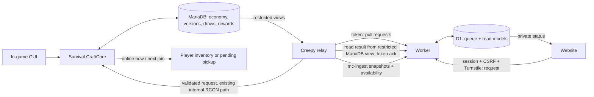

# Gacha: technical design for approval

Status: **approved by Nils 2026-11-05.** Items marked *default, Nils may change* are safe defaults that can be changed later without a new approval round. Not implemented; the implementation order is in §8.1. This is the contract for the implementation PRs, not a description of live behaviour. Nils's decisions below override older satchel behaviour and any conflicting mockup. Website/Worker changes belong in `NwebNotFound/NwebNotFound`; Creepy changes belong to the Discord maintainer. No real money, paid CP, subscriptions, or payment provider is involved.

### Changes 04.11.2026

**Rev 1** (first review round). Added on Nils's feedback to this PR: **§5.1** item value score (`Wert`), tier fit and ability gate; **§5.2** satchel expected value, balance bar and publish warnings with example numbers for the five Beutel; **§6.1** ability limits (uses/charges, cooldown, depletion, durability, charge storage in the PDC); plus the matching schema fields in §2 and the new test cases in §8.

**Rev 2** (addresses the review on this PR). Abilities were almost invisible in `W`: `A` is rescaled from `(P/4)·K·L` (≤ 25 WP) to `P × 6 × K × L` (2–600 WP), so the ability term now has the same order of magnitude as `B` (cap 480 WP). Every worked example, the tier `W` bands (now derived as raw `B+E+A` × `T`) and the §5.2 numbers were recomputed, and the three ability Beutel got new example prices (Baumeister 200 → 210, Wochenbanner 350 → 400, Ausrüstung 450 → 550 CP) so all five stay in green; the Rohstoffe and Baumeister pools carry no abilities, so their average `W` is unchanged. The worked examples were re-checked against the ability gate (row 1 is an `R` item now, plus one explicit gate violation, one over-tier and one under-band case). The ability → minimum tier mapping is its own table instead of an offset column, `EV` is labelled in WP instead of CP, the defaults cover a full registry of all 25 known abilities (the "list still missing" note is obsolete), and question 1 is gone. Documentation only — no code, migration, deploy or restart in this PR. All numbers are proposals for approval and are computed with the formulas in §5.1/§5.2, not measured production values.

**Rev 8** (05.11.2026, Nils's decision). `SELL_BOUND` is dropped: no market-wide sell ceiling. Instead **every pulled item carries a hidden PDC tag**, stackable Rohstoffe included, and the bank and market refuse tagged items; mined items keep normal prices. The tag carries through crafting, smelting and the other transformations, placed tagged blocks drop tagged again, and `RESALE_LOOP` stays only for the paths no tag can follow (§3, §5.2, §7.1). Player-to-player CP trades stay allowed.

**Rev 7.1** (05.11.2026, review, replaced by Rev 8). Invariant `SELL_BOUND`: a monotone per-material bank sell ceiling, written at publish and applied inside every sell price computation, protects rewards already delivered against later price increases (§2, §3).

**Rev 7** (05.11.2026, review). The 10-pull discount is covered by the resale guarantee: `RESALE_LOOP` caps every resource entry against the cheapest effective per-pull price, and stackable rewards need no tag (§3, §5.2).

**Rev 6** (05.11.2026, Nils's mockup answers). Decided: stackable Rohstoffe rewards get **no serial**; only special gacha items get a serial and `gezogen von` (§7.1). A group such as *Holz* adds **each member as its own pool entry**. The 10-pull has a **discount editable per Beutel**. The item editor is **its own page**.

**Rev 5** (05.11.2026, Nils's answers to the last open items). Admins are everyone with the Discord admin role (§5). Beutel can be built from **item groups** (equipment, blocks, items, materials, wood, earth, …) with include/exclude, as well as from hand-picked items (§5). The launch weekly banner is **Miner's Delight**. Safe defaults for the test context and the D1 budget (*default, Nils may change*). New §8.1: implementation order, satchel editor first. Spec approved.

**Rev 4** (05.11.2026, Nils's answers to the open questions). Spec approved except the remaining items at the end. Proposed defaults accepted for all tuning questions (prices/odds, warn-only value checks, variant ladder, Grubenlicht trigger, safety floors, announcement tiers, "Im Besitz" as last-seen, wave bounds, `needs_review`, value-model weights). Decided: `/N` in the serial label is the count of existing copies, there is **no supply cap** and no `SOLD_OUT`; serials count per rarity variant. Player-to-player trades for CP are allowed (player shops, `/trade`, AH listings between players); still no server buy-back. A confirmed duplicate is **frozen automatically** and admins are alerted in Discord (channel is a config value).

**Rev 3** (05.11.2026, Nils's decisions from `ROADMAP.md` "Phase 2: Gacha system"). New **§1.1** decision summary and reset times (daily 05:00, weekly Monday 05:00 Europe/Berlin). Prices, odds and ability limits are **editor values**; every number in this spec is only a default. Value score and `EV` are a balancing aid: their checks now **warn** and no longer block publication (§5.1/§5.2); only structural, price > 0 and anti-OP safety checks still block. Ability limits are now one of three **limit types** (`uses`, `timed`, `unlimited`, §6.1), the ability minimum-tier gate is replaced by **rarity variants** (same item and ability in several tiers, rarer = more uses, §6.2), and Grubenlicht is a timed ability. Used-up items **never break**: they lose the ability and stay as a trophy (`Fähigkeit erschöpft`, no glint); `item_breaks`/`stays_normal` are gone. New **§7.1** serial numbers, `gezogen von`, "Gezogen" vs "Im Besitz", trading/gifting and the duplicate alarm, **§7.2** announcements with a configurable threshold (chat + website), **§7.3** the SSR+ display case on the profile, plus the card-deck reveal with summary (§4, §7). Cooldowns now follow the item instance, not the player, so a trade cannot reset them. Fixed a pre-existing arithmetic slip: Erzspürer 4 uses is `A` 107, not 89 (89 is the 3-use value). Documentation only.

## 1. Decisions, existing system and flow

- Only CP earned in game pays for pulls. 1 CP = 100 integer cents. One pull or 10 independent pulls; the 10-pull costs `10 × cost_cents` minus the Beutel's editable 10-pull discount (§5); duplicates remain items, with no duplicate compensation. No pity, guarantee, minimum rarity for 10, or hidden odds adjustment. Order high to low: `SSR+`, `SSR`, `SR`, `S`, `R`, `UC`, `C`.
- Resources (coal through diamond), building (daily wood/stone/etc. theme), weekly themed banner (launch: *Miner's Delight*; e.g. Ninja, SSR+ grapple), equipment (lore, balanced stats), and adventure (rare useful abilities). Pools contain both vanilla and custom items. Actual prices, contents and chances need approval; do not infer production values from the mockups.
- The plugin is the sole roller and CP authority. MariaDB is authoritative for definitions, publication, schedules, account balances, draw outcomes and outstanding rewards. D1 is an untrusted, eventually consistent view plus a transport queue; it is authoritative only for its own queued request until the plugin decides it, never for money, winners, or delivery. Browser reveals are presentation only.

### 1.1 Nils's decisions (05.11.2026)

| Topic | Decision | Where |
|---|---|---|
| Authority and currency | Server-authoritative; paid only with in-game CP. Items are very rare; nothing is free (no starter, bonus or daily free pull). | §1, §3 |
| Tiers | `SSR+` > `SSR` > `SR` > `S` > `R` > `UC` > `C`. | §2 |
| Beutel | Rohstoffe (resources), Baumeister (daily theme), Wochenbanner (weekly banner; launch banner *Miner's Delight*, later e.g. a Ninja set with an SSR+ Enterhaken), Ausrüstung (equipment with lore and stats, not OP), Abenteuer (e.g. Flucht aus den Minen, Grubenlicht helmet). | §5.2 |
| Reveal | Card deck, one card per tap, rarest last, then a quick summary of all results. Website and in-game. | §4, §7 |
| Editors | Website item editor and Beutel editor. Prices and odds are **fully editable**; spec numbers are defaults. Value score per item and `EV` per Beutel are shown as a balancing aid only; no item is ever sellable for that value. | §5 |
| Abilities | 25 abilities; each has a limit type: number of uses, timed duration per activation, or unlimited. Set in the editor. | §6.1 |
| Rarity variants | Same item with the same ability may exist in several tiers; rarer = more uses (e.g. `SSR+` unlimited or many, `C` 1–3). | §6.2 |
| Grubenlicht | Timed activation; duration and number of activations depend on tier and editor setting. | §6.1, §6.2 |
| Used up | The item does not break. It loses the ability and stays as a trophy (lore `Fähigkeit erschöpft`, no glint), e.g. for item frames. | §6.1 |
| Announcements | Very rare pulls are announced in server chat and on the website; the tier threshold is configurable. | §7.2 |
| Display case | SSR+ collection on the player profile, with empty slots for SSR+ items not yet collected. | §7.3 |
| Ownership | Unique serial (`#12/50`) and `gezogen von <Spieler>` in item PDC and DB; uses belong to the item; profile shows "Gezogen" (permanent) and "Im Besitz" (current holder, updated when the server sees the item); trading and gifting allowed; the same serial seen twice raises a duplicate alarm to the log and Discord. | §7.1 |
| Reset times | Daily 05:00 Europe/Berlin (Baumeister theme, daily limits); weekly banner Monday 05:00 Europe/Berlin. | §2 `gacha_schedule` |
| Quality bar | Polished lore and a polished display case. | §7 |

Baseline at mc-stack `e58cd17` / website `6c10bb5` (source, not verified deployment): `Satchels.java`, `SatchelStore.java`, `SatchelOdds.java` already charge through `EconomyStore.change` with `SecureRandom` in `core.tx` and insert `satchel_claims`. They implement **pity SR/SSR**, a single combined item-weight lottery, and lack tier `S`; `/satchel` displays pity. Those must change, not coexist as a bypass. `BankBuy.java` uses `bank_buy_orders` and a request-ID journal, transactionally commits charge and `pending_deliveries`; `Deliveries.java` and `/abholen` implement pickup, but inventory and DB cannot commit atomically. `ECONOMY-AUDIT.md` records this boundary. Existing `Satchels.deliver` marks a claim given before `addItem` and writes leftovers later: a crash can lose an item; do **not** claim exactly-once delivery today. SQL work currently in delivery on the main thread must move off it.

Creepy's `bot/relay.py` polls `mc-shop-orders/pending?types=shop,bank_buy` every 60 s with `x-ingest-token`, validates links, calls internal RCON, persists retries in SQLite and reads final bank results from MariaDB before ack. `bot/ingest.py` pushes server status every 60 s to `POST /api/mc-ingest`; website `src/worker.js` merges it into D1 `mc_snapshot`. `src/mc-trade.js` provides the analogous queue and Discord link checks; its Turnstile is currently optional, **not sufficient** for this design. `docs/vip-api.md` is a second queue/ack contract. None of these existing paths already supports gacha. Never expose RCON/DB or an ingest credential to the browser.

## 2. Data model and versioning

Names below are proposed migrations, not existing tables. UUIDs are canonical strings, times UTC epoch milliseconds except D1's existing session schema. Constraints are explicit and migrations additive; no dropping existing player data, claims or pity rows. Money and weights are integer; immutable version rows are never updated after publication. All server writes are InnoDB transactions. Validate FKs and indexes in actual migration tests.

### MariaDB: authoritative

| Table | Columns and constraints | Indexes / use |
|---|---|---|
| `gacha_items` | `item_id` UUID PK, `family_id` UUID, `name_key`, `created_by_uuid`, `created_at`; stable identity of one rarity variant; variants of the same item and ability share `family_id` (§6.2) | PK; `(family_id)`; serials count per `item_id` |
| `gacha_item_versions` | `(item_id, version)` PK; `material`, `name_components_json`, `lore_json`, `rarity`, `max_durability`, `start_damage`, `unbreakable`, `enchantments_json`, `attributes_json`, `custom_model_data_json`, `bound`, `stack_size`, `definition_hash`, `created_at`, `state` | FK item; immutable snapshots; validate allowlists and limits, not arbitrary NBT or commands |
| `gacha_item_abilities` | `(item_id, item_version, slot)` PK; `ability_id`, `ability_schema_version`, `params_json`, `limit_type` (`uses`, `timed`, `unlimited`), `uses_max` (activations for `uses`/`timed`, 0 for `unlimited`), `duration_seconds` (only `timed`, else 0), `cooldown_seconds` (0 = none), `consumes_durability` | FK item version; v1 allows 0 or 1 ability, framework allows later slots with explicit combination checks; `CHECK` that the fields match `limit_type`; editor values validated against the registry safety caps in §6.1 (minimum cooldown, maximum duration), never free-form |
| `gacha_satchels` | `satchel_id` UUID PK, `slug` UNIQUE, `enabled`, `created_at` | unique slug |
| `gacha_satchel_versions` | `(satchel_id, version)` PK; `display_name`, `kind` (`permanent`, `daily`, `weekly`), `cost_cents`, `ten_discount_ppm` (0..500,000, default 100,000 = 10 %; the 10-pull price `ten_pull_price = floor(10 × cost_cents × (1 − ppm/1,000,000))`, always > 0), `definition_hash`, `state`, `published_at`, `published_by_uuid` | FK satchel; positive checked price, immutable once published |
| `gacha_tier_weights` | `(satchel_id, version, theme_id, rarity)` PK; `weight_ppm` | FK version; exactly 1,000,000 ppm across all 7 tiers per resolved theme; zero allowed only for absent tier |
| `gacha_groups` | `(group_id, version)` PK; `name`, `kind` (`builtin`, `custom`), `rule_json` (vanilla tags, creative categories, explicit materials, excludes), `created_by_uuid`, `created_at` | immutable versions; resolved to materials only on publish (§5) |
| `gacha_pool` | `(satchel_id, version, theme_id, rarity, item_id, item_version)` PK; `item_weight`, `quantity`, `source_group` nullable | FK tier and item version; `item_weight > 0`, quantity bounded and safe as an inventory stack; every positive tier has entries; item rarity matches tier |
| `gacha_schedule` | `schedule_id` UUID PK, `satchel_id`, `version`, `theme_id`, `kind`, `weekday` nullable, `starts_at`, `ends_at` nullable, `timezone`, `priority` | `(satchel_id, starts_at, ends_at)`; no overlaps for same satchel; intervals `[start,end)`; daily schedule resolves local calendar date and handles DST deterministically; gaps disable pulls. Default boundaries: daily rotation and daily limits reset at **05:00 `Europe/Berlin`**, weekly banner starts/ends **Monday 05:00 `Europe/Berlin`**. 05:00 is outside both DST switch windows (02:00–03:00), so every local day has exactly one 05:00; the stored `starts_at`/`ends_at` are the UTC instants of those local times |
| `gacha_requests` | `request_id` UUID PK (same ID on D1 and server), `player_uuid`, nullable `discord_id`, `source`, `satchel_id`, `count`, `expected_version`, `max_cost_cents`, `payload_hash`, `created_at`, `expires_at`, `status`, `reason`, `resolved_version`, `theme_id`, `charged_cents`, `committed_at` | PK; `(player_uuid,created_at)`; status `committed`, `rejected` or `expired` (request may initially be D1-only); unique ID bound to canonical payload |
| `gacha_draws` | `(request_id, ordinal)` PK, `rarity`, `item_id`, `item_version`, `quantity`, `tier_roll`, `tier_total`, `item_roll`, `item_total`, `pool_hash`, `delivery_id`, `created_at` | FK request/item; unique `delivery_id`; ordinal 0..count-1. Immutable audit with versioned pool, weights and outcomes; don't log RNG secrets |
| `gacha_deliveries` | `delivery_id` UUID PK, `request_id`, `ordinal`, `player_uuid`, immutable item snapshot/serialized data, `quantity`, `cap_cents`, `state`, `attempt_id`, `updated_at`, `last_error` | UNIQUE `(request_id,ordinal)`, `(player_uuid,state,updated_at)`; `pending`, `in_progress`, `delivered`, `needs_review` |
| `gacha_instances` | `instance_id` UUID PK, `item_id`, `item_version`, `serial_no`, `delivery_id`, `pulled_by_uuid`, `pulled_at`, `holder_uuid` nullable, `holder_seen_at`, `holder_location` (`inventory`, `ender_chest`, `container`, `item_frame`, `unknown`), `uses_left_seen`, `exhausted_at` nullable, `frozen_at` nullable | UNIQUE `(item_id, serial_no)`, UNIQUE `delivery_id`, `(pulled_by_uuid)`, `(holder_uuid)`; `serial_no` assigned in the pull transaction (§3, §7.1); `pulled_by_uuid` never changes; holder/uses columns are a **last-seen view** written by the plugin, not authority over the PDC |
| `gacha_dupe_alerts` | `alert_id` UUID PK, `instance_id`, `first_seen_json`, `second_seen_json`, `created_at`, `state` (`open`, `resolved`) | `(state, created_at)`; one row per detected duplicate, never deletes or modifies items on its own (§7.1) |
| `gacha_settings` | `key` PK, `value_json`, `version`, `updated_by_uuid`, `updated_at` | versioned admin settings, e.g. `announce_min_tier` (§7.2); changed only through the audited admin path of §5 |
| `gacha_admin_changes` | `request_id` PK, `actor_discord`, `actor_uuid`, `operation`, `expected_version`, `payload_hash`, `result`, `created_at` | `(actor_uuid,created_at)`; logs proposal, validation, publish or rejection without credentials |
| `gacha_admin_staging` | `request_id` PK, `actor_discord`, `actor_uuid`, `payload_json`, `payload_hash`, `created_at`, `expires_at` | PK; bounded untrusted proposal envelope, never published state; bot may INSERT/SELECT only, no UPDATE/DELETE or economy grants |
| `gacha_outbox` | `event_id` increasing PK, `request_id` nullable, `kind` (`result`, `delivery`, `announce`, `dupe_alert`, `holder_update`), `subject_key`, `payload_version`, `payload_json`, `created_at` | unique `(kind,subject_key,payload_version)` where `subject_key` names the one thing the event is about: `request_id` for `result`, `delivery_id` for `delivery`, `request_id:ordinal` for `announce`, `alert_id` for `dupe_alert`, `instance_id:holder_seen_at` for `holder_update`; so one request can emit one result, several deliveries and several announcements, and alerts/holder updates without a request fit too; relay reads via restricted view/cursor; retains replayable results and separate delivery updates |

Production uses the existing `accounts(uuid,balance)` row and its locking rules; do not create a second balance. One reward row may represent multiple units only if the cost cap and recovery rules apply to the entire quantity. Item snapshots must include all actual values, not just a reference to mutable configuration. On publication, store a canonical full pool hash. On retries use it and the original result, not current banner data.

Definition state and instance state stay separate: the tables above store only declared limits and pool data. Remaining charges, live cooldowns and the item `Wert` are **not** authoritative engine columns — charges live on the item instance, cooldowns in the persisted per-instance row (§6.1), `gacha_instances.uses_left_seen` is only a last-seen copy for the profile, and the value is deterministically derived from the immutable snapshot on every save, publish and preview (§5.1). No client, D1 or relay payload field for charges, value or durability is ever persisted; only the plugin can write them.

### D1: projection and queue only

| Table | Columns | Indexes / use |
|---|---|---|
| `mc_gacha_catalog` | `id` PK = `current`, `version`, `catalog_json`, `updated_at` | PK; bounded public published satchels, schedules, prices, all tier/item odds and item display metadata; no unpublished definitions |
| `mc_gacha_requests` | `id` PK, `discord_id`, `mc_uuid`, `satchel_id`, `count`, `expected_version`, `max_cost_cents`, `payload_hash`, `created_at`, `expires_at`, `status`, `reason`, `result_json`, `delivery_state`, `result_version`, `updated_at` | PK; `(status,created_at,id)` for bounded relay poll, `(discord_id,created_at,id)` for own history. `pending` → final plugin `committed`/`rejected`/`expired`; monotonic delivery version, idempotent ack. 10 results in one bounded JSON row |
| `mc_gacha_admin_queue` | `id` PK, `actor_discord`, `actor_uuid`, `operation`, `expected_version`, `payload_json`, `payload_hash`, `created_at`, `status`, `reason`, `result_version` | `(status,created_at,id)`, `(actor_discord,created_at,id)`; drafts/proposals, not authoritative published items |
| `mc_gacha_feed` | `event_id` PK (= MariaDB `gacha_outbox.event_id`), `mc_name`, `item_name`, `rarity`, `serial_label`, `created_at` | `(created_at)`; public announcement feed (§7.2), bounded to the latest 50 rows, only committed non-test pulls at or above the threshold |
| `mc_gacha_collection` | `(mc_uuid, item_id)` PK, `pulled_count`, `owned_count`, `best_serial_label`, `updated_at` | PK; profile read model for "Gezogen", "Im Besitz" and the SSR+ display case (§7.1, §7.3); pushed by the relay, never written from the browser |
| `mc_gacha_rate` | `(bucket_type, bucket_key, window_start)` PK, `count`, `updated_at` | PK; fixed windows for account and keyed IP hash, no raw IP; atomic conditional upsert/batch, bounded windows, no historical `COUNT(*)` scans |

Reuse `sessions`, `mc_links`, server portion of `mc_snapshot` and published ranks where appropriate. Admin authorization at the Worker uses an indexed, fresh projection of the Discord admin role (§5), pushed by Creepy; Creepy and the plugin recheck the live role at execution. Versioned ack must never overwrite a newer or terminal state with an older state. For pulls, the relay needs only SELECT views: a strict console-only plugin command accepts validated IDs and bounded typed arguments. For admin proposals Creepy rechecks identity, inserts the bounded canonical envelope into `gacha_admin_staging` using a separate narrowly scoped INSERT/SELECT DB principal, and dispatches only the ID and hash. The plugin reads the staging row, checks identity, deadline, hash, current permission and full schema before any publish; the bot cannot update the row or publish definitions. Duplicate staging ID with different payload is rejected. Audit every privilege grant. Never concatenate raw free text into RCON; no new public host listener.

Existing `satchels`, `satchel_items`, `satchel_pity` and `satchel_claims` stay intact. Migration must preserve and deliver all old open claims and their cap; map legacy published satchels to explicit versioned tier probabilities, including absent S, only after review. Existing claims retain their exact item bytes; no reroll. Disable old pity and old draw entry points atomically with enabling the new engine; keep `/satchel` as an alias or documented safe migration. No fallback to the old pity engine if new tables are missing. Take a backup before any future migration/deploy; rollback must preserve any post-migration draws/claims and is not a destructive restore.

## 3. Drawing, atomicity and recovery

At execution of a website request, Creepy rechecks the exact Discord↔UUID pair against its active SQLite link and the Discord role immediately before dispatch, failing closed if either is unavailable. Its trusted, console-only typed dispatch carries request ID, Discord ID, UUID and validated pull fields; the plugin checks their syntax, binding and deadline and independently checks survival availability, active schedule, published version and exact confirmed max price. D1's link is only an admission hint; the authenticated relay is trusted for the live link assertion, so test revocation races and keep the assertion/dispatch window short. In-game requests use the authenticated player UUID directly and do not require a Discord link. Website gets the version and exact price before consent; if either changed, reject `STALE_CATALOG`/`PRICE_CHANGED` without charge. Resolve theme by the server's clock at execution; a changed theme/version requires renewed consent, never a silent substitution.

Within one MariaDB transaction: insert/lock `gacha_requests` by `request_id`; mismatching immutable payload => `ID_CONFLICT`, identical final => return prior result. Lock the published resolved version and the account row, check sufficient cents and `Math.multiplyExact`; for each of 1 or 10 independent outcomes use `SecureRandom.nextLong(bound)` (unbiased bounded sampling), first against 1,000,000 tier ppm, then against the sum of positive item weights in that tier. `P(item) = tier_ppm / 1,000,000 × item_weight / tier_item_weight_sum`. One item per outcome; store both sampled integers, bounds, immutable pool/version hash, item and quantity. No seeded client RNG, no reroll on retries, no pity state. Debit via `EconomyStore.change`, insert request, all draw/delivery rows, one `gacha_instances` row per non-stackable item (next `serial_no` for that `item_id` under a row lock; there is no supply cap, so serial assignment never rejects a pull) and outbox in the **same** commit. An insufficient balance or invalid pool creates a durable rejected request without debit; exceptions roll everything back. With simultaneous in-game/web requests the existing account row lock serializes spending; DB unique keys, not the in-memory `busy` set, enforce idempotency. Timeout or lost ack retries the same ID; relay reads final journal/outbox before declaring anything failed.

Crash before commit: no charge or result. Crash after commit but before delivery/ack: original charge, results and pending deliveries survive; replay outbox, no second charge. Expiry is checked against DB time inside the plugin transaction immediately before debit; a request first executed after its deadline is rejected on replay even if the server later starts. A transaction that passed the deadline check may commit just after the deadline: it remains the one authoritative result. Never let D1 independently mark a request failed/expired while a plugin transaction may have committed; if the outcome is unknown, show `processing/reconciliation`, not `failed` or a refund. Network recovery reconciles by ID; never silently create a replacement ID.

**Inventory boundary / release gate:** MariaDB and Paper player-data saves are not one atomic transaction. A journal alone cannot guarantee exactly once across a crash after inventory mutation but before durable save/DB ack, or vice versa. Design a unique delivery receipt, async DB reservation, main-thread inventory operation, forced/durable player save and startup/join reconciliation of the receipt against player data, including partial/full inventory and concurrent joins. Receipt must survive transfers, stacking and consumption until reconciliation; do not assume this without a proven design. If proof is impossible for a crash window, park it as `needs_review`, do not blindly redeliver or mark delivered, alert an admin with the immutable snapshot, and require an explicit reconciliation procedure. The implementation PR must demonstrate crash injection at every boundary and document remaining ambiguity; otherwise automatic production delivery is blocked. Do not claim exactly-once semantics. Online delivery is attempted promptly; offline delivery on next Survival join, leftovers remain pending and `/abholen` remains available. Ensure main-thread-only Bukkit access and async SQL.

Preserve existing satchel cap on old rewards. New reward resale must not create a guaranteed CP loop: bound items have no bank/player trade payout; the guarantee is a **tag** (Nils, 05.11.): every item delivered from a pull, stackable Rohstoffe included, carries the hidden PDC key `gacha:origin` (value `1`, identical on every unit, so tagged stacks merge with each other; they do not merge with untagged mined items, which is accepted). **Every server buy path refuses tagged items**: bank `/sell`, sell GUI, sell chest, satchel resale, market sell orders and the website bank quote count only untagged units and say `Gacha-Items kann die Bank nicht ankaufen.` for the rest. Untagged, normally mined items keep their normal prices; there is no market-wide ceiling. Player-to-player trades for CP stay allowed (§7.1).

The tag follows the item through every transformation the plugin can see, so a tagged input never becomes sellable by processing:

| Path | Rule |
|---|---|
| Crafting table, inventory crafting, Crafter (`CraftItemEvent`, `CrafterCraftEvent`) | result tagged if any ingredient is tagged |
| Furnace, blast furnace, smoker, campfire (`FurnaceSmeltEvent`, `BlockCookEvent`, also hopper-fed) | result tagged if the source is tagged |
| Stonecutter, smithing table, anvil, grindstone, loom, cartography (`PrepareResult` / result-take events) | result tagged if any input is tagged |
| Placing a tagged block | position stored in the chunk PDC (`gacha:placed`); break, explosion, piston move and silk-touch drops at that position are tagged again; the mark is cleared when the block is gone |
| Villager and wandering-trader trades, composter, brewing stand, beacon payment | tagged items are refused as input (no untagged output can come out) |
| Dropping, chests, hoppers, shulker boxes, death drops, player trades | the item keeps its PDC unchanged |

Paths no tag can follow (growth from planted tagged seeds or saplings, spreading blocks such as grass, moss or mycelium, bone-meal effects, farms fed by tagged items) are covered by the publish check `RESALE_LOOP` (§5.2), which now applies **only to pool entries whose material is on the reviewed list `market.gacha-untrackable`** (plantables and spreadables); for those entries `quantity × max bank sell` of the material must stay below the cheapest effective per-pull price `min(cost_cents, ten_pull_price / 10)`. All other entries need no price check because their units can never reach a server buyer untagged. The check is re-run when bank prices or the list change; a Beutel that starts failing is closed until a corrected version is published. Gacha item instances (everything with a serial, §7.1) have **no** server buy-back (bank, `/sell`, market sell) at any price, and the `Wert` is never a sale price. Player-to-player transfers are allowed, including trades for CP through player shops, `/trade` and AH listings between players; CP only moves between players there, the server never mints CP for a gacha item. PDC tags carry `gacha:origin` on every gacha item and, on serialized items, identity, version, serial, `pulled_by`, cap/binding and receipt; protect crafting, smithing, furnaces, stonecutter and Crafter as well as all other transformations. Evaluate recipes and player shops/AH/trade, containers, hoppers, drops, death and cross-server transfers. Preserve normal sale of non-gacha dirt, cobblestone and tools; `market.unsellable` stays empty. If the cap/identity cannot survive a path, block that path for tagged rewards until proven safe. `bound` means owner-bound, not a cosmetic label: define owner checks and exhaustive transfer tests before publication. Because trading and gifting are allowed, `bound` defaults to `false` and is an exception an admin must set explicitly.

## 4. Website API, liveness and D1 budget

Proposed endpoints, all additions to the existing Worker routing:

- `GET /api/mc-gacha/catalog` → published catalog + version, schedule, UTC times and seven explicit tier percentages plus per-item probabilities; cache short/public only for catalog.
- `POST /api/mc-gacha/pulls` → `{request_id,satchel_id,count,expected_version,theme_id,max_cost_cents,turnstile}`; `count` exactly 1 or 10. Discord session and verified active linked role determine UUID server-side; never accept buyer UUID or price as authority. Exact approved HTTPS Origin, CSRF token bound to session, JSON-only, mandatory server-verified Turnstile fail-closed, request/body limits. Idempotent identical replay returns same request; same ID/different payload or identity is 409. New request returns 202 `pending`; 401/403 for auth, 409 stale catalog, 429 rate limit, 503 for stale/offline status or unavailable DB. Resolve request ID before consuming extra rate quota for legitimate retries.
- `GET /api/mc-gacha/pulls/{request_id}` → session must own the request; private `no-store`, 404 for absent/foreign ID, pending or plugin result forwarded by the authenticated relay and delivery state. Result is one bounded row; no public caching of player data.
- `GET /api/mc-gacha/pending?limit=50` and `POST /api/mc-gacha/ack` → only `x-ingest-token`, bounded batches, idempotent request ID and monotonically increasing result version. Ack includes exact committed results or terminal rejection, then later delivery state. Extend Creepy's SQLite retry/outbox and the restricted MariaDB view; never invent a terminal result from a timeout. Ack loss/repeated polls are safe.

Availability: extend the existing 60 s Servers-Push with a separate survival **CraftCore gacha-ready heartbeat**, generated only by the enabled, healthy plugin and seen by Creepy, not just a Minecraft ping. A Worker accepts new requests only if online and heartbeat ≤75 s old, catalog fresh and bridge healthy; plugin checks again during execution. Heartbeat is a best-effort admission hint, not proof that a server cannot stop one instant later. If server or bridge stops after 202, request remains unresolved; plugin's 180 s deadline ensures it cannot debit on a later restart after expiration. If the plugin committed before a lost response, eventually show that original result, even after the deadline. No offline queue that executes later.

UI: one shared in-flight request per user/tab with cross-tab coordination, disable repeat click, retry using same ID. Poll at 10, 20, 30, 45, 60, 90, 120, 150 s after 202 (maximum eight), pause when tab hidden and resume within the same window; after that show unresolved and explicit manual recheck, not an automatic infinite poll. Status access is rate-limited too. Reveal is a **card deck**: a committed 10-pull is sorted on the client **C, UC, R, S, SR, SSR, SSR+** (rarest last), stable by original ordinal for ties; cards lie face down, one card flips per tap or key press, SSR+ gets a short cinematic then continue, finally a quick summary of all results (tier, name, serial, `Ladungen`/duration) with "skip to summary" always available. A single pull is a one-card deck. Sorting does not affect draws. Closing the tab doesn't cancel, refund, or reroll. Announce failures and delivery status accessibly.

D1 free tier currently allows **5,000,000 rows read and 100,000 rows written per day, account-wide**, with indexes adding writes; verify current limits and budget against the whole site, not just this feature. Source: [Cloudflare D1 pricing](https://developers.cloudflare.com/d1/platform/pricing/). Worker already documents 03.11's history scan that exhausted the read limit (`src/worker.js`, `histPct`). Example conservative planning model, **not measured**: one accepted request, 1 or 10 results in one row, eight status polls, one relay fetch, one ack, two delivery state changes; indexed point reads, no retries. Estimated 8 initial row reads (session, link, snapshot, catalog, idempotency, account/IP/global fixed rate buckets), 16 status reads (session + owned request per poll), 1 relay row and 1 ack lookup = **26 reads/request**. Budget up to **20 written rows/request**, including three atomic rate-bucket updates, queue insert, terminal ack, two delivery updates and secondary index entries; actual engine/index costs must be measured, not assumed. Also reserve 1,440 reads/day for one empty relay query/minute, conservatively even if an empty indexed query reports zero; 1,440 incremental heartbeat writes/day and 20 catalog writes/day, even if existing server snapshot coalescing avoids some.

| Requests/day (1 or 10 items each) | Estimated added reads/day | Estimated added writes/day |
|---:|---:|---:|
| 100 | 1,440 + 100 × 26 = 4,040 | 1,460 + 100 × 20 = 3,460 |
| 1,000 stress case | 1,440 + 1,000 × 26 = 27,440 | 1,460 + 1,000 × 20 = 21,460 |

Excludes existing site workload, retries, catalog page views, admin edits, migrations, cleanup and unusual multi-tab clients; therefore not a hard upper bound. D1 bills rows scanned, including index effects, not returned rows or HTTP requests. Require `EXPLAIN QUERY PLAN`, D1 `meta.rows_read`/`meta.rows_written` for each statement and account dashboard metrics under concurrent requests with representative history. Cap normal gacha contribution (*default, Nils may change*) at 50,000 reads and 10,000 writes/day, reserve headroom for existing traffic; stress table is a capacity thought experiment, not permission to exceed that cap. Alert at 50%/80% of the feature budget and disable **new** requests on threshold or D1 errors, preserving status, reconciliation and acks; never enable a paid plan. Counter enforcement must be concurrency-safe across Worker isolates (D1 atomic conditional batch or a verified free-tier shared limiter), not in-memory only. Initial limits: 2 new requests/min and 10/hour per Discord account, 4/min and 20/hour per keyed IP hash; stricter global cap if measured load warrants. Fixed windows and polling limits do not scan draw history; expiry/retention only via approved, indexed, bounded maintenance, never delete records without Nils's approval.

## 5. Admin editors and release workflow

Admin is not inferred from UI. **Admin = every member with the Discord admin role** (Nils, 05.11.), resolved through the linked Discord account; the role ID is a config value (`gacha_settings.admin_discord_role_id`, mirrored in Creepy's config), not a LuckPerms rank. Worker requires the same session, a verified Discord link, a fresh role projection that contains that role, strict Origin/CSRF and mandatory Turnstile for mutations. A separate admin queue routes a versioned proposal through Creepy; Creepy rechecks the actor's live Discord role and active link immediately before dispatch, and the plugin rechecks Creepy's signed assertion and the link at execution, failing closed if any is unavailable. In-game admin commands use the same rule: the player's linked Discord account must hold the role. Only the plugin validates and publishes. Restrict relay secrets/DB views and log actor, immutable request ID, previous/new version, validation failures and approval result. A stale expected version returns conflict; no last-write-wins overwrite. Enforce payload size/schema and use a fixed registry of ability IDs, never scripts, arbitrary commands or executable text.

Item editor (**its own page** on the website, separate from the Beutel editor; a Beutel picks published items from it): allowed base material; styled name and lore using bounded sanitized structured components, no click/hover commands or unsafe HTML; rarity; maximum/starting durability and unbreakable; allowlisted compatible enchantments and levels; bounded attribute operation/slot/amount and aggregate/equipped-combination caps; ability ID + typed parameters; Custom Model Data as supported by the deployed Paper version; binding, stack size and live tooltip. Anti-OP validation is server-side on save **and** publish; an unbreakable item must still obey all caps. Numeric per-material/per-attribute maxima and prohibited combinations are explicit, reviewed versioned server policy, not adjustable by ordinary editor form or client payload. Changes to those rules need a separately reviewed PR and tests. No unsupported attributes, unsafe enchants or unregistered abilities; show precise validation errors. Preview is not authoritative. Every item additionally shows its computed `Wert` and tier verdict with the ability's limit type, uses or activations × duration, cooldown and durability (§5.1, §6.1); those fields are not optional for any item that carries an ability. The editor offers "Varianten" to create the same item and ability in further tiers with the §6.2 defaults pre-filled.

**Editable vs. fixed.** Admins edit freely: Beutel prices, tier odds, item weights and quantities, schedules, item texts, and every ability limit (type, uses, duration, cooldown) within the registry safety caps. Spec numbers are only the defaults the editor pre-fills. Fixed, reviewed server policy (changed only by its own PR): anti-OP caps on attributes/enchantments, the ability registry with its safety caps (minimum cooldown, maximum duration/radius), the `Wert` formula and its weights. Value and `EV` checks (§5.1, §5.2) are a **balancing aid** and only warn; publication is blocked only by structural errors, `INVALID_PRICE`, anti-OP caps and registry safety caps.

#### 5.1 Item value score (`Wert`) and tier fit

The editor must answer two questions before anything is published: does an item match its rarity, and is a satchel worth its price? Both use one server-computed number, the `Wert` in value points (WP). It is a balancing aid only: not a price, not a bank value, not sellable and never convertible to CP in any code path, never credited, never read by a pull, refund, trade or market. `1 WP` is roughly the utility of 1 CP of bank value on tier `C`, which serves only as a mental anchor for reading the number. No editor field can set `W` directly.

`W = T(rarity) × (B + E + A)`, integer, computed server-side from the immutable version snapshot and deterministic; editor preview, save validation, publish validation and the simulation all call the same function, and only the server result counts (a client-sent value is ignored, like every other preview value in §5).

| Term | Definition | Anchor numbers |
|---|---|---|
| `B` base value | Reviewed market table (`config.yml` `market.min-price`/`max-price`) × quantity plus the plain vanilla value of the base item. For equipment `B` is capped at 480 WP (the price of three diamonds), so an expensive material cannot carry an item alone and the value must come from stats or the ability; resource bundles use the market price uncapped, because there the material is the reward. | iron ingot ≈5 CP, diamond ≈160, netherite ingot ≈3200; iron pickaxe `B` = 15, diamond pickaxe 480, netherite boots capped at 480 instead of ≈3200 |
| `E` enchantments/stats | Reviewed per-enchantment weight × level: Efficiency 8, Fortune 20, Mending 25, Silk Touch 30, Protection 12, Sharpness 12, Unbreaking 10, Looting 18. Levels above the vanilla maximum count ×0.5 and only where the review allows it. Allowlisted attributes get fixed weights (+1 attack damage 4, +1 armour 3, +10% speed 5). Aggregate and combination caps from §5 bound `E`. | Efficiency II = 16, Protection IV = 48, Silk Touch = 30 |
| `A` abilities | `A = P × 6 × K × L` per ability slot, integer with the division floored. `P` reviewed power rating 1..100 from the ability registry in §6.1 (never an editor field); `K` cooldown factor in percent: ≤5 s 100, ≤30 s 85, ≤2 min 70, ≤10 min 55, longer 45; `L` lifetime factor in percent: `unlimited` 100; `uses` `min(85, 25 + 12 × uses)` (1 use 37, 3 uses 61, 5 uses 85); `timed` the same with `uses = activations × duration_seconds / 300`, floored, minimum 1 (one 5-minute block counts as one use). | Erzspürer 4 uses/60 s (`P` 35) = 107; Grubenlicht timed 3 × 5 min, no cooldown (`P` 8) = 29; Enterhaken unlimited/20 s (`P` 30) = 153; Heimkehr 3 uses/10 min (`P` 40) = 80; Flucht aus den Minen 3 uses (`P` 45) = 90 |
| `T` rarity factor | `C` 1.00, `UC` 1.15, `R` 1.35, `S` 1.65, `SR` 2.10, `SSR` 2.80, `SSR+` 3.60. Prices rarity and prestige, not raw power: `T` makes tiers comparable inside one pool and feeds §5.2, so a high tier never needs inflated stats to feel valuable. | SSR `T` 2.80 |

Why the constant `6`: `P` spans 1..100, so `P × 6` spans 6..600 and a legal ability lands between 2 and 600 WP. `B` is capped at 480 WP for equipment and `E` typically stays under 120, so at the top end the ability is the largest single term (1.25 × the `B` cap) without making material and stats irrelevant; a median ability (`P` 25, 30 s cooldown, unlimited) is 127 WP, about a quarter of `B` max and roughly four times the `B+E` of an iron pickaxe with Efficiency II. The old `(P/4)·K·L` topped out at 25 WP (5 % of `B` max), which hid the very thing a player pulls for: the unlimited grappling hook moved the SR diamond pickaxe example by 22 of 1093 WP (2 %); with the new constant it is 321 of 1392 WP (23 %) and decides the tier verdict. Raising the constant further (e.g. 10) would let a single ability outscore a full netherite kit and flatten the material and stat terms, so `A` stays below `1.5 × B` max.

Tier bands (`W`, checked against the item's own tier). They are defined once in raw pre-rarity points (`B+E+A`) and multiplied by `T`, so they scale with rarity instead of drifting whenever a tier is added:

| Tier | Raw band `B+E+A` | `W` band (`T` × raw, rounded) |
|---|---:|---:|
| `C` | 10–260 | 10–260 |
| `UC` | 25–420 | 30–480 |
| `R` | 55–670 | 75–900 |
| `S` | 110–910 | 180–1500 |
| `SR` | 160–1100 | 340–2300 |
| `SSR` | 250–1210 | 700–3400 |
| `SSR+` | 420–1335 | 1500–4800 |

The raw ceiling rises towards the largest legal composition (`B` 480 + `E` 200 + `A` 600 = 1280 raw), so a higher tier may use more of the same budget. For `SSR+` the ceiling (1335 raw = 4800 `W`) sits above that maximum, so the top tier can never be flagged `zu stark`; there the anti-OP limits and the value concentration check are the guardrail.

There is **no minimum tier per ability** any more: with rarity variants (§6.2) every ability may exist on every tier, and the tier is expressed through its limits (a `C` Erzspürer has 1 use, an `SSR+` one is unlimited). Bands overlap on purpose: a strong `C` gear item can legitimately be worth more than weak `SR` resource bundles, so the band is a guardrail against an item that is out of its league, not a strict partition. Over-band = `zu stark` (`ITEM_OVER_TIER`) and under-band = `zu schwach` (`ITEM_UNDER_TIER`) are **warnings**: the admin sees them on save and publish and must tick "trotzdem veröffentlichen", which is logged in `gacha_admin_changes`. A variant family whose rarer variant has fewer uses/activations, shorter duration or a longer cooldown than a commoner one warns `VARIANT_ORDER`. The bands are versioned review policy like the anti-OP limits, not editable in the form.

Worked examples (server formula, `A` floored by integer division, `W = T × (B+E+A)` rounded to the nearest integer):

| Item | `B` | `E` | `A` | `W` | Band | Verdict |
|---|---:|---:|---:|---:|---|---|
| `R` iron pickaxe, Efficiency II, Erzspürer 4 uses | 15 | 16 | 107 | 186 | R 75–900 | `passt` |
| `SR` diamond pickaxe, Silk Touch, Enterhaken unlimited | 480 | 30 | 153 | 1392 | SR 340–2300 | `passt` |
| `SSR` netherite boots, Protection IV, Heimkehr 3 uses | 480 | 48 | 80 | 1702 | SSR 700–3400 | `passt` |
| `C` wooden pickaxe, Erzspürer 1 use (rarity variant) | 2 | 0 | 54 | 56 | C 10–260 | `passt` |
| `UC` iron helmet, Grubenlicht timed 3 × 5 min | 25 | 0 | 29 | 62 | UC 30–480 | `passt` |
| `UC` netherite sword, Sharpness V, Enterhaken unlimited | 480 | 60 | 153 | 797 | UC 30–480 | `zu stark` warning `ITEM_OVER_TIER` |
| `C` wooden pickaxe, no ability | 2 | 0 | 0 | 2 | C 10–260 | `zu schwach` warning |

The same iron pickaxe as row 1 without an ability scores 42 and is `zu schwach`, so the ability is what carries the verdict — the intended effect of the rescale. Row 4 is the rarity-variant case: Erzspürer on a `C` item is legal now, its single use keeps it in the `C` band. Row 5 assumes an iron helmet `B` of 25 (market value of five ingots). Row 6 is the anti-OP case: a cheap-rarity label on a netherite blade with a strong enchant and ability overshoots `UC` by 317 WP; the admin gets the warning and must confirm it, and the separate anti-OP caps of §5 still apply.

Editor display: a value badge on each item card (`Wert 186 WP`), a tier-fit chip (`passt`, `zu stark`, `zu schwach`), a breakdown popover with `B`, `E`, `A`, `T` and the ability term including its `P`, `K`, `L` and chosen limit type, uses/duration and cooldown, the delta against the previous version, and the same number in the live tooltip. Value checks never block: they come back from the server on save and publish as stable warning codes (`ITEM_OVER_TIER`, `ITEM_UNDER_TIER`, `VARIANT_ORDER`) that need an explicit, logged confirmation; preview is not authoritative.

Satchel editor: pool entries come from two sources that can be mixed in one Beutel: **hand-picked items** (any published gacha item version) and **item groups**. A group is a named, versioned set of Minecraft materials (`gacha_groups`): built-in groups derived from vanilla item tags and creative categories (e.g. *Ausrüstung*, *Blöcke*, *Items*, *Materialien*, *Holz*, *Erde*, *Erze*) plus admin-defined groups. The admin picks a group, then excludes single items or adds extras. **Each member becomes its own pool entry** (adding *Holz* lists oak log, spruce log, … as separate rows with their own weight, quantity and tier); a group-wide weight and quantity are only the pre-filled values and can be overridden per row. Only materials that are obtainable in Survival and pass the anti-OP and `market.unobtainable` rules can be members. On **publish** the plugin resolves every group into explicit `gacha_pool` rows (a plain vanilla material becomes an auto-generated `gacha_item_versions` row without ability) and stores them in the immutable version, so a later group or tag change never alters a live Beutel and the published odds stay exact; `gacha_pool.source_group` keeps the origin for the editor display. Then: choose permanent/daily/weekly, name, integer CP cost and the 10-pull discount (`ten_discount_ppm`, default 10 %, max 50 %); per-theme seven tier probabilities in integer ppm totalling exactly 100%, positive integer per-item weights, quantity and versioned item reference. Reject missing nonzero-tier items, overflow, malformed dates, overlaps, mismatched rarity or invalid items. Preview exact odds and per-item odds. Simulate 100/1,000/10,000 independent pulls locally with clearly labelled non-production randomness and no CP/item effects; show distribution and expectation, never imply a guarantee. Only the plugin publishing the whole immutable version changes live pools. Scheduled daily rotations and weekly starts/ends show timezone explicitly; no auto-default to an unspecified zone. The editor also shows the expected value, balance bar and publish warnings of §5.2 for the version being edited.

#### 5.2 Satchel expected value, balance bar and publish warnings

Expected value per pull is `EV = Σ P(item) × W(item)` over every pool entry, using the same integer probabilities as §3 (`tier_ppm / 1,000,000 × item_weight / tier_item_weight_sum`) computed from the immutable version being edited. Ten pulls are `10 × EV` because pulls are independent and there is no pity (§1); the balance bar for the 10-pull compares `10 × EV` with the discounted 10-pull price, so a large discount moves it towards `grenzwertig`. Because gacha items are not sellable (§3), `EV` is not a CP refund and never becomes a payout: it measures what a player receives, not what can be cashed out, and no configuration may create a CP loop. The editor also shows median and P90 from the local 10,000-pull simulation (§5) and the SSR/SSR+ frequency as "1 in N pulls".

The balance bar compares `EV / cost` for a single pull:

| Zone | `EV / cost` | Effect |
|---|---|---|
| red `zu stark` | ≥ 1.00 | warning `EV_TOO_HIGH` + explicit Nils approval: the Beutel gives more value than it costs. No CP loop is possible because nothing is sellable for its `Wert` |
| yellow `grenzwertig` | 0.85–0.99 | warning; publication needs a written justification in the proposal |
| green `passt` | 0.55–0.84 | normal |
| yellow `dünn` | 0.40–0.54 | warning; publication needs a written justification |
| red `zu schwach` | < 0.40 | warning + explicit Nils approval; never silent |

Further publish checks (all evaluated server-side on publish; a warning is never hidden and needs an explicit, logged "trotzdem veröffentlichen"):

| Check | Threshold (default, versioned policy) | Effect |
|---|---|---|
| Item over / under its tier | `W` outside the §5.1 band | warning `ITEM_OVER_TIER` / `ITEM_UNDER_TIER` |
| Variant order | rarer variant weaker than a commoner one (§6.2) | warning `VARIANT_ORDER` |
| SSR+ frequency | > 0.50% per pull (1 in 200) | warning `SSR_PLUS_TOO_COMMON`; recommended 0.15–0.30% for permanent/daily Beutel |
| SSR frequency | > 3.00% per pull | warning |
| Value concentration | one item > 25% of `EV` | warning `VALUE_CONCENTRATION` (a "Beutel" that is really one item) |
| Resale loop (untrackable materials only) | entry material on `market.gacha-untrackable` and `quantity × max bank sell` > `min(cost_cents, ten_pull_price / 10)` (§3) | **block** `RESALE_LOOP`; re-checked on bank-price or list changes, failing Beutel close |
| Free or negative price | `cost_cents` ≤ 0 | **block** `INVALID_PRICE`: nothing is free, no starter or bonus pulls |
| Anti-OP or registry safety cap | §5 caps, §6.1 minimum cooldown / maximum duration | **block** `ITEM_UNSAFE` / `ABILITY_LIMIT_UNSAFE` |
| Empty positive tier, ppm ≠ 1,000,000, weight ≤ 0 | — | **block**, already rejected by the §5 satchel editor |

Example numbers for the five planned Beutel — **editor defaults, not approved prices or odds**; admins change them in the Beutel editor; tier columns are percent per pull, `C`/`UC`/`R`/`S`/`SR`/`SSR`/`SSR+`, `EV` in WP:

| Beutel | Cost CP | Tier split % | `EV`/pull WP | `EV`/cost | SSR+ | Verdict |
|---|---:|---|---:|---:|---|---|
| Rohstoffe | 150 | 42.0 / 30.0 / 19.0 / 7.0 / 1.7 / 0.3 / 0 | 115.6 | 0.77 | – | green `passt` |
| Baumeister (daily) | 210 | 39.0 / 30.0 / 20.0 / 8.5 / 2.0 / 0.35 / 0.15 | 171.1 | 0.82 | 1 in 667 | green, upper edge |
| Wochenbanner (Ninja) | 400 | 35.0 / 28.0 / 20.0 / 10.0 / 4.5 / 2.0 / 0.5 | 300.6 | 0.75 | 1 in 200 | green `passt` |
| Ausrüstung | 550 | 40.0 / 28.0 / 18.0 / 9.0 / 3.5 / 1.2 / 0.3 | 434.6 | 0.79 | 1 in 333 | green `passt` |
| Abenteuer | 500 | 42.0 / 30.0 / 16.0 / 8.0 / 2.8 / 1.0 / 0.2 | 343.6 | 0.69 | 1 in 500 | green `passt` |

The per-tier average `W` behind those numbers is what the pool editor must actually reproduce (`–` = tier not in that pool):

| Beutel | `C` | `UC` | `R` | `S` | `SR` | `SSR` | `SSR+` |
|---|---:|---:|---:|---:|---:|---:|---:|
| Rohstoffe | 40 | 90 | 180 | 340 | 620 | 1100 | – |
| Baumeister | 54 | 122 | 243 | 459 | 837 | 1485 | 2600 |
| Wochenbanner | 60 | 180 | 340 | 620 | 1050 | 1800 | 3200 |
| Ausrüstung | 120 | 332 | 564 | 977 | 1654 | 2781 | 4300 |
| Abenteuer | 50 | 300 | 520 | 900 | 1550 | 2600 | 4000 |

`EV` is `Σ tier share × average W` over all seven tiers, and every average sits inside its own §5.1 band, so a pool entry that reproduces these averages cannot be an out-of-league item. The resource and building pools carry no abilities, so their `W` and `EV` are unchanged by the `A` rescale; the three ability pools rise because `A` now counts, and their example prices rose with them (Baumeister 200 → 210, Wochenbanner 350 → 400, Ausrüstung 450 → 550 CP; no price went down). Equivalent 10-pull expectations: 1156 / 1711 / 3007 / 4346 / 3436 WP. Every Beutel keeps a positive sink of at least 18.5 % of its spend (Baumeister, the tightest), and the weekly banner remains the only one at the 0.5 % SSR+ ceiling. Raising a tier share, adding ability items to a pool or cutting any cost without cutting the pool moves the bar out of green and the publish is flagged.

Display: badge per item, tier chip, `EV` per pull and per 10 both in WP, balance bar with the five zones and the warnings named inline (`EV_TOO_HIGH`, `SSR_PLUS_TOO_COMMON`, `VALUE_CONCENTRATION`), the SSR+/SSR "1 in N" lines, and the concentration table of the top five EV contributors. All of it is a balancing aid; the editor never sells, never converts to CP and never changes the published version. Only the plugin publishing the whole immutable version changes live pools; preview is not authoritative.

**Test pulls, default (*default, Nils may change*):** the editor's "Testziehung" runs server-side: the plugin draws from the *draft* version with the same draw function the pull engine uses later (same validation, `SecureRandom`, odds; built in §8.1 step 1) and returns the cards, but debits no CP, writes no `gacha_draws`, `gacha_instances` or deliveries, and creates no item; only an audit row in `gacha_admin_changes`. The reveal is shown in the editor. This needs no isolated world and is the only test mode in v1.

Later option, disabled by default: `Im Spiel testen (an mich)` creates a separately audited, admin-only, rate-limited **test-mode** request. The plugin rechecks the admin, applies the same validation, and offers an ephemeral, visibly tagged test item only in an isolated non-economic test context: no CP, no real reward/delivery, trading, storage, dropping, market, other-player transfer, or permanent world changes. No test item may persist into production inventory. If that isolation and safe cleanup cannot be proven, keep the button disabled and provide tooltip preview only; do not silently gift items. Publication is a separate explicit action. Ability cooldown/test effects cannot alter real claims or resource economy.

## 6. Ability framework and first wave

Registry maps stable `ability_id` + schema version to server-owned handlers with typed validated params, safe defaults, max/min, events, permission/world/claim checks and cleanup. PDC carries item ID, immutable item version, owner/binding and per-instance ID where necessary; lore/name is never authority. Only server creates and verifies stamps; ignore unknown or invalid versions. Persist cooldown deadlines per `(instance_id, ability_id)` — they follow the item like its uses, so trading or gifting cannot reset them — where restarting would otherwise bypass them; synchronize online instances across backends. Event listeners run on Paper's main thread; DB, heavy queries and precomputation off-thread with bounded work and cancellation. Hooks cover interaction, sneak/move/damage, break/pickup/equipment, quit/death/world change and plugin shutdown; respect WorldGuard, CraftCore claims, existing teleport rules, PvP and protected inventories. Rate-limit particles/sounds and don't load arbitrary chunks. Failure must be safe, not silently bypass protection. Registering a new ability requires ID/schema, handler, declared event subscriptions, validation/permissions/cooldown, resource budget and unit + integration tests; editor receives a read-only capability/schema catalog, never code. Ability stacking is denied until reviewed.

#### 6.1 Ability limits: limit types, cooldown, exhaustion and charge storage

Every ability on an item carries exactly one **limit type**, set in the editor per item version:

| `limit_type` | Meaning | Fields | Lore |
|---|---|---|---|
| `uses` | a number of uses; each applied effect spends one | `uses_max` ≥ 1 | `Ladungen: 3/5` |
| `timed` | a number of activations; each activation runs for a fixed duration, then ends on its own | `uses_max` ≥ 1 activations, `duration_seconds` ≥ 1 | `Aktivierungen: 2/3 · je 5:00` |
| `unlimited` | no use counter | — | `Unbegrenzt` |

Additionally `cooldown_seconds` (`0` = none, never below the registry minimum) and `consumes_durability` (whether normal item damage also applies). Cooldown combines with every type, e.g. Erzspürer with 4 uses and a 60 s cooldown can be used at most once per minute until the uses are gone. A `timed` activation spends its activation when it starts; it ends early only on death, logout, world change, unequipping or server stop, and the rest of that activation is lost (no pause/resume exploit). `unlimited` without a cooldown is a deliberate exception that the editor flags for review, not a default.

**Exhaustion, no breaking.** When the last use or activation is spent, the item never breaks or disappears. The plugin removes the ability stamp, keeps every identity tag (`item_id`, version, serial, `pulled_by`), removes the enchantment glint (`enchantment_glint_override = false`), and renders the lore line `Fähigkeit erschöpft` under the original lore, so it stays a trophy for item frames and the display case. Exhaustion is idempotent and recorded in `gacha_instances.exhausted_at` when the server next sees the item. Normal durability still applies to the base item; an exhausted tool can still be used as a plain tool if its material allows it, and keeps its serial when repaired.

Charges are item state, never a server or client counter:

- Stored in the item PDC as `gacha:ability_id`, `gacha:instance_id`, `gacha:limit_type`, `gacha:uses_max`, `gacha:uses_left`, `gacha:duration_seconds`, `gacha:active_until` (only while a `timed` activation runs), `gacha:charges_version`; the persisted cooldown row `(instance_id, ability_id)` from §6 stays separate, so neither a restart, a relog nor a trade refunds a cooldown or a charge. Uses belong to the item, not the player.
- Written only by the plugin. The client, website, D1, the request payload, the relay and the admin proposal never carry or decide a charge count; the plugin stamps `uses_max`/`uses_left` from the immutable version at delivery and again on reconciliation from the same snapshot. A website or bot payload field that claims charges is ignored exactly like any other client-supplied authority field (§3, §4).
- Any item with a per-instance counter is forced to `stack_size = 1`; identical-looking stacks must never share or split a counter. The satchel editor may not give a charged item a stack size > 1.
- `uses_left` is debited exactly once per successful, actually applied effect, in the same main-thread operation that writes the cooldown. If a protection, PvP, claim, permission or world check cancels the effect, or the effect throws, the charge is restored within that tick: no partial consumption, no negative count, and repeated triggers at 0 are a no-op (depletion is idempotent).
- Refill is impossible in v1: anvil repair and rename, grindstone, Mending, enchanting, crafting, smithing, inventory sorting and repair-cost tricks must all leave `uses_left` untouched, and those paths are covered by the transformation checks in §3. A later recharge feature needs its own reviewed rule (explicit cost, cap, never free) and its own PR.
- Lore is rendered server-side from the PDC, not frozen in the snapshot text, so a stale string can never show more charges than the item holds: `Fähigkeit: Erzspürer`, `Ladungen: 3/5`. The immutable version stores the template with a placeholder plus `uses_max`. An optional live line (`Bereit in 42 s`) appears only in the held-item tooltip, rate-limited.
- Charges ride on the item, so duplicating an item duplicates its charges: the tag and transfer protection of §3 is a precondition for publishing any charge-limited item. The database only keeps a last-seen copy (`gacha_instances.uses_left_seen`), never used to restore; a lost item loses its charges, and there is no restore path.
- When the last use or activation is spent the item becomes a trophy as described above; the reveal and the item preview say so before the pull is confirmed (`Wird nach der letzten Ladung zur Trophäe`).

Registry of all 25 abilities (proposal, review required). `P`, the safety caps (minimum cooldown, maximum duration) and the wave are reviewed registry policy and read-only in the editor. The `Default` column is only what the editor pre-fills for a new item; limit type, uses, duration and cooldown are editor values (§5), and §6.2 derives the per-tier defaults from it. Lowering a safety cap needs a new ability schema version in its own PR. Wave 1 is the eight abilities already registered and testable; waves 2 and 3 are documented here so the editor and the value model cover them, but they stay non-selectable until their own handler PR passes review.

| `ability_id` | Ability | Effect (one line) | `P` | Default limit | Default cooldown | Durability | Wave |
|---|---|---|---:|---|---:|---|---|
| `grapple` | Enterhaken | pull the player toward a traced block | 30 | `unlimited` | 20 s | yes | 1 |
| `double_jump` | Doppelsprung | one extra jump before landing | 18 | `unlimited` | 10 s | yes | 1 |
| `climb_claws` | Kletterkrallen | climb or vault low walls while held, bounded stamina | 20 | `unlimited` | 5 s | yes | 2 |
| `glide_hang` | Gleitumhang | slow, steered glide while sneaking in open air | 24 | `unlimited` | 3 s | yes | 2 |
| `path_runner` | Wegläufer | speed bonus while walking on player-made paths | 14 | `unlimited` | 15 s | yes | 3 |
| `silent_step` | Leiser Schritt | no step sound, smaller mob detection radius | 10 | `unlimited` | 30 s | yes | 3 |
| `mine_escape` | Flucht aus den Minen | still sneak for 5 s, teleport to a safe surface | 45 | `uses` 3 | 10 min | no | 1 |
| `homeward` | Heimkehr | right-click recall to the approved home point | 40 | `uses` 3 | 10 min | no | 1 |
| `recall_death` | Rückruf | teleport back to your last death point | 55 | `uses` 2 (1–2) | 30 min | no | 3 |
| `soul_pouch` | Seelentasche | one death without item loss, contents stay | 50 | `uses` 1 | – | no | 3 |
| `lava_reflex` | Lava-Reflex | pull back to the last safe block instead of dying in lava | 45 | `uses` 3 | 10 min | no | 2 |
| `deep_breath` | Tiefenatmer | longer underwater breath, faster swimming | 22 | `unlimited` | 5 min | no | 3 |
| `miners_light` | Grubenlicht | worn helmet lights the area for its wearer | 8 | `timed` 3 × 5 min | none | no | 1 |
| `ore_sense` | Erzspürer | coarse direction and count of nearby ore | 35 | `uses` 4 (3–5) | 60 s | no | 1 |
| `track_sense` | Spurensucher | shows the trail back to where you came from | 20 | `uses` 6 (4–8) | 60 s | no | 2 |
| `weather_frog` | Wetterfrosch | short forecast of incoming weather | 6 | `unlimited` | 60 s | no | 3 |
| `glow_arrow` | Leuchtpfeile | arrows leave a temporary light where they land | 14 | `unlimited` | 10 s | yes | 3 |
| `lumberjack` | Holzfäller | fell connected natural logs, at most 16 | 22 | `unlimited` | 2 s | yes | 1 |
| `harvest_sickle` | Erntesichel | 3×3 crop harvest with replant | 18 | `unlimited` | 2 s | yes | 2 |
| `smelt_strike` | Schmelzhauer | mined ore drops already smelted | 16 | `unlimited` | 1 s | yes | 2 |
| `magnet` | Magnet | attract nearby drops within 3 blocks | 12 | `unlimited` | 5 s | yes | 1 |
| `line_builder` | Linienbauer | place a straight line of blocks from the inventory | 10 | `unlimited` | 5 s | yes | 3 |
| `self_repair` | Selbstflicker | repairs the item with the holder's XP | 24 | `unlimited` | 60 s | no (repairs) | 3 |
| `fish_luck` | Fischglück | better fishing loot rolls | 10 | `unlimited` | 60 s | yes | 3 |
| `smoke_bomb` | Rauchbombe | PvE-only smoke that breaks mob targeting | 20 | `uses` 3 (2–4) | 60 s | no | 3 |

Nothing in the registry is OP by design: everything that changes location, information or death outcome is charge-limited (`ore_sense`, `track_sense`, `mine_escape`, `homeward`, `recall_death`, `soul_pouch`, `lava_reflex`), convenience and mobility are capped by cooldown plus the item's own durability, and the two life/combat entries stay small (`fish_luck` only touches fishing loot rolls, `smoke_bomb` is explicitly PvE-only and has no effect on players in a PvP context).

Special safety concerns for the new entries (each must be proven in its handler PR before enablement, otherwise the ability stays disabled):

- `soul_pouch` Seelentasche changes death drops, so it must interoperate with `keepInventory`, other plugins' death handlers, claims and inventory overflow: exactly one save per death, no refund after the death already paid out, no duplication with satchel leftovers; if the interaction cannot be proven, stay disabled.
- `recall_death` Rückruf: a death point is not automatically safe or reachable — require a safe-spot check, same world only, no combat/PvP/claim bypass, and a bounded lifetime for the stored point (proposal 30 min, relog only, no cross-server).
- `lava_reflex` Lava-Reflex: it fires in the tick before the fatal damage only. It may never undo a death that already happened, never grant an invulnerability window, and spends no charge when no safe block exists.
- `line_builder` Linienbauer: blocks come only from the player's own inventory, one permission/claim check per block, bounded length, no duplication on cancel, disconnect or server stop.
- `self_repair` Selbstflicker: XP goes through the normal cost path, it never repairs other items or the ability stamp, it cannot stack with Mending into free repair, and its cooldown prevents XP-farming an unlimited tool.
- `harvest_sickle` Erntesichel: replants only the same crop, respects block provenance and claims, no seed duplication, bounded to 3×3.
- `smoke_bomb` Rauchbombe is PvE-only: no effect on a player target in any PvP context and no combat-log or escape abuse.
- `track_sense` Spurensucher is information, so it is charge-limited and must not reveal other players' bases, claims or offline activity; trail length is bounded.

Rule for the waves: strong utility (information, escape, recall — `ore_sense`, `track_sense`, `mine_escape`, `homeward`, `recall_death`, `soul_pouch`, `lava_reflex`) is use-limited below `SSR+`; convenience and mobility use cooldown plus durability; Grubenlicht is `timed`. These limits feed the value formula in §5.1, so editing `uses` from 5 to 3 visibly lowers `W` and the satchel `EV`, and changing a limit after publication requires a new item version — no in-place edit of a live item.

**Safety caps (registry, not editable):** the cooldown floor is the listed default cooldown for the seven strong-utility abilities and 50 % of it for all others; `soul_pouch` can never be `unlimited`; a `timed` activation lasts at most 10 min. An editor value below a floor is rejected `ABILITY_LIMIT_UNSAFE`.

#### 6.2 Rarity variants

The same item with the same ability can exist in several tiers. Each tier is its own `item_id` (own serial counter, own display-case slot) sharing one `family_id`. Rarer = more uses. The editor's "Varianten" button pre-fills these defaults from the registry `Default limit` `D`, which is the `R` value; every number stays editable:

| Tier | `uses` / `timed` activations (round half up, min 1) | `unlimited` abilities: cooldown factor (never below the floor) |
|---|---|---:|
| `C` | `D × 0.5` | 1.50 |
| `UC` | `D × 0.75` | 1.25 |
| `R` | `D` | 1.00 |
| `S` | `D × 1.25` | 0.90 |
| `SR` | `D × 1.5` | 0.80 |
| `SSR` | `D × 2.5` | 0.70 |
| `SSR+` | `unlimited` with the default cooldown; strong utility `D × 4` instead, `soul_pouch` `D × 4` | 0.60 |

Examples: Erzspürer (`D` 4) → `C` 2, `UC` 3, `R` 4, `S` 5, `SR` 6, `SSR` 10, `SSR+` 16 uses. Flucht aus den Minen (`D` 3) → 2 / 2 / 3 / 4 / 5 / 8 / 12. Grubenlicht (`timed`, `D` 3 × 5 min) → 2 / 2 / 3 / 4 / 5 / 8 activations of 5 min, `SSR+` unlimited. Enterhaken (`unlimited`, 20 s) → cooldown 30 / 25 / 20 / 18 / 16 / 14 / 12 s (floor 10 s). The duration per activation is the same in every tier by default; the editor may raise it up to the 10-minute cap.

| Wave 1 | Trigger / mechanics | Initial bounds and safety gates (proposals) |
|---|---|---|
| `grapple` Enterhaken | Right-click, ray trace block, pull **player** toward point | ≤16 blocks; 20 s cooldown; no entity hooks, protected destinations, cross-world/chunk loads or fall-damage bypass; velocity capped; cancel on quit/world change |
| `mine_escape` Flucht aus den Minen | Sneak and stand still 5 s; teleport to safe surface | 10 min cooldown; cancel on any movement, damage, release, logout; Survival overworld only; find safe loaded surface with solid floor, two air blocks and WorldGuard/claim permission; no safe spot = no teleport/no cooldown; never bypass combat/teleport restrictions |
| `miners_light` Grubenlicht | Sneak + right-click while wearing the helmet starts one `timed` activation; the area lights up for its wearer until the duration ends | Activation spends one; boss bar countdown; ends early on unequip, death, logout, world change, stop; bounded radius/updates; use a verified Paper-compatible non-destructive, per-player light solution; never permanently place/delete blocks or modify protected chunks. If compatibility cannot be proven, keep disabled |
| `double_jump` Doppelsprung | One extra jump before landing while wearing item | 10 s cooldown; cap velocity; no creative-flight override, elytra/PvP/claim bypass; restore prior flight state on removal/quit; test anticheat compatibility |
| `lumberjack` Holzfäller | Break a log with item; process connected logs | ≤16 natural connected logs, one bounded batch, no leaves/player-placed blocks; normal break events, durability and drop rules for each; check permission on each block, stop on cancel/unloaded chunk; default disabled until provenance is reliable |
| `magnet` Magnet | Equipped/held item attracts nearby dropped items | ≤3-block radius, bounded entities/tick, only drops player is already allowed to pick up; obey owner delays, claims and inventories; no through-wall/other-player theft |
| `ore_sense` Erzspürer | Right-click to sense nearby ore | ≤8 blocks, 60 s cooldown, only loaded chunks and authorized area; coarse direction/count, no exact wallhack coordinates or protected-area leakage; bounded scan, configurable ore allowlist |
| `homeward` Heimkehr | Right-click, then normal warm-up | Reuse existing approved home teleport target, delay, cancellation, cost and safety/claim checks; 10 min cooldown; no free bypass of existing costs, combat or dimensions |

These numerical caps are conservative implementation proposals, not approved balance. The full set of 25 abilities is known (mockup session 03/04.11.2026) and is registered in §6.1 with a stable `ability_id`, so the editor, the rarity variants and the value model already cover all of them. Only the eight wave-1 abilities are registered handlers, testable today, and selectable in the editor; the wave 2/3 entries stay non-selectable until their own handler PR documents mechanics and bounds like the wave-1 table above and passes the safety review. `McItemEditor.html` references `{{abilities}}` dynamically and does not contain the names, so the registry — not the mockup — is the source of truth for IDs, defaults and tiers.

## 7. In-game UX and announcement

`/gacha` opens the Survival GUI (and `/satchel` aliases the same engine). List active Beutel, theme/end time, cost, exact rarity/item chances, one/ten buttons and explicit no-pity text. Each item preview shows its ability limits from §6.1 (charges as `Ladungen: 3/5`, cooldown, and what happens when the last charge is spent) and never promises more uses than `uses_max`; the `Wert` from §5.1 is an admin-only number and never appears in player UI. Confirm total CP and pool version, then show the result as the same card deck as the website (one card per click in a chest GUI, rarest last, then a summary page) or a clear insufficient-balance/stale/unavailable message. Do not display a guaranteed interval; expected SSR+ frequency is only a mathematical average. Inventory full/offline shows pending pickup, not failure; never expose another player's requests. Reveal sound/title uses actual result. Announcements follow §7.2.

### 7.1 Serials, "gezogen von", ownership and duplicate alarm

- Every non-stackable gacha item gets a `gacha_instances` row in the pull transaction (§3): `serial_no` counts per `item_id` (= per rarity variant) from 1. The label is `#<serial_no>/<copies>` (`#12/50`), where `copies` is the number of instances of that variant pulled so far; it is rendered server-side from `gacha_instances`, so `/50` grows as more copies are pulled. There is no supply cap. PDC: `gacha:instance_id`, `gacha:serial`, `gacha:pulled_by` (UUID) and `gacha:pulled_at`; lore renders `#12/50 · gezogen von <Name>` from the PDC (current name looked up by UUID, so a rename stays correct). Stackable resource rewards (Rohstoffe) get **no serial** (Nils, 05.11.): no `gezogen von`, no "Gezogen"/"Im Besitz" entry and no duplicate alarm. They carry only the hidden `gacha:origin` tag (§3), so they stack with each other but not with mined items, and the bank does not buy them. Only special (non-stackable) gacha items are serialized.
- Uses belong to the item (§6.1), so a traded item keeps its uses, cooldown and exhaustion.
- **Gezogen** (permanent): every instance the player ever pulled, from `pulled_by_uuid`; never decreases, also after trading, exhaustion or loss.
- **Im Besitz** (current holder): updated when the server sees the item — on join, quit, inventory open/close, ender chest, container close, item frame interaction, pickup and death drop — via an async, coalesced last-seen write (`holder_uuid`, `holder_location`, `holder_seen_at`, `uses_left_seen`). It is "last seen", not live: an item in an unopened chest keeps its last holder, and the profile says "zuletzt gesehen <Datum>".
- **Trading and gifting** between players are allowed (drop, chest, `/trade`, player shops and AH listings, also for CP). No server buy-back for any instance (§3).
- **Duplicate alarm:** if the server sees the same `instance_id` twice at once — two stacks in one scan of loaded inventories/containers, or a sighting at holder B while holder A's online inventory still contains it — it writes one `gacha_dupe_alerts` row, logs `GACHA_DUPLICATE <instance_id> <serial>` and sends a `dupe_alert` outbox event that Creepy posts to the admin channel configured in `gacha_settings.dupe_alert_channel`. Every copy carrying that `instance_id` is **frozen automatically**: the plugin sets `gacha:frozen` in the PDC wherever it sees the item, the ability no longer triggers and the lore shows `Gesperrt – wird geprüft`; `gacha_instances.frozen_at` records it. Freezing never deletes, moves or takes an item and changes no CP. An admin resolves the alert and can unfreeze the genuine copy (audited in `gacha_admin_changes`).

### 7.2 Announcements

Committed, non-test pulls at or above `gacha_settings.announce_min_tier` (default `SSR+`, editable in the admin editor; options `SR`, `SSR`, `SSR+`, off) are announced:

- **Server chat:** one line on all Survival/lobby backends, e.g. `✦ Steve hat Enterhaken [SSR+] #3/50 aus dem Wochenbanner gezogen!` Rate limit and coalescing: one per player per minute, one global per 10 s, several hits of one 10-pull become one line.
- **Website:** a bounded public feed (`mc_gacha_feed`, latest 50) on mc.nwebnotfound.dev, shown as a ticker on the gacha page.
- Never announce tests, rejected or rolled-back requests, and never include private data beyond the Minecraft name, item, tier and serial.

### 7.3 SSR+ display case on the profile

The player profile on mc.nwebnotfound.dev gets a "Vitrine" section: one slot per published `SSR+` item (all `SSR+` `item_id`s ever published, in publication order). Collected slots show the item render, name, serial and "Gezogen"/"Im Besitz" status; exhausted trophies show `Fähigkeit erschöpft` without glint. Not-yet-collected slots stay visible as empty, dimmed silhouettes with the name and the Beutel it came from, so the case shows what is still missing. Below it: counters "Gezogen" and "Im Besitz" for all tiers. Data comes from `mc_gacha_collection` and the public catalog; no private data is shown. A Designer mockup is required before implementation (rule 8).

## 8. Small PRs, tests and acceptance gates

All implementation requires this design's approval first; each PR reviewed and CI green. No PR below implies deployment. Bot work is handed to the Discord owner with a `bot/changelog.json` entry; Worker/site work to Cloudflare owner. Cross-repo contracts and feature flags must land in compatible order. Do not expose a feature in a partially deployed state.

1. **CraftCore core/migration:** additive schema, seven tiers/no pity, serial assignment in the pull transaction, 05:00 `Europe/Berlin` daily/weekly boundaries, immutable versions, SecureRandom two-stage selection, idempotent transaction, legacy-claim preservation, safe disabled-by-default `/gacha` alias. Tests: odds boundaries and zero tiers, serial uniqueness under concurrent pulls, `/copies` label growing with each pull, schedule boundaries at 04:59/05:00 on both DST switch days, exact ppm, deterministic injected RNG, independent 10 pulls, stale/expired/insufficient balance, concurrent double IDs and account races, DB rollback, old claims and S. Acceptance: one charge and exactly one DB result/claim per ordinal; no player-data deletion or old-engine bypass.
2. **Delivery hardening:** receipts, crash reconciliation, async SQL, full inventory and protected-item/market enforcement. Fault-injection tests before/after every DB, inventory and save boundary, join/quit, multi-server, partial stacks, transformation/sale paths. Acceptance: no silent loss/duplicate; unresolved windows visibly `needs_review`; production auto-delivery remains disabled until the inventory guarantee and manual procedure are reviewed.
3. **Creepy bridge:** scoped SELECT views, readiness, bounded poll, validated console dispatch, SQLite retries/outbox/ack, current-link checks and changelog. Tests: offline/start-after-expiry, revoked link, fake fields, retries, outage and lost ack. Acceptance: no direct public ports, no duplicate charge; final state reconciles after restart.
4. **Worker/D1:** additive migrations, auth/CSRF/mandatory Turnstile, rate buckets, indexed queue/status/ack and catalog, liveness/expiry semantics, measured D1 cost and flag. Tests: authorization, CSRF, Turnstile failure, no cross-user read, concurrency, stale prices, duplicate and out-of-order ack, query plans + row metrics. Acceptance: bounded costs under budget and no D1 monetary authority.
5. **Website player UX:** catalog, odds, 1/10 consent, bounded polling, accessibility, card-deck reveal (rarest last, skip, summary) and recovery, announcement feed, profile "Gezogen"/"Im Besitz" and SSR+ display case (mockup first). Tests: offline/error/pending, repeated clicks/tabs, 1/10 with multiple SSR+, no invented results, mobile and keyboard. Acceptance: all results correspond exactly to the committed plugin draw; no paid path.
6. **Admin editors:** item/satchel proposal, plugin validation and versioned publish, safe simulation/test mode. Tests: non-admin/stale Discord admin role and concurrent edit, unsafe NBT/enchants/attributes, overflow, schedule boundaries/DST, malicious text, invalid ability, test isolation, deterministic server-side value computation and its caps, tier-band, variant-order and EV/balance **warnings** (never blocking) with logged confirmation, `RESALE_LOOP` blocks for 1-pull and discounted 10-pull prices incl. re-check after a bank-price change, `gacha:origin`: a delivered stack is refused by every server buy path while an identical mined stack sells normally; the tag survives crafting, Crafter, every furnace type incl. hopper feed, stonecutter, smithing, anvil and grindstone; a placed tagged block drops tagged after break, explosion and piston move; villager, composter, brewing and beacon refuse tagged input; `RESALE_LOOP` only fires for `market.gacha-untrackable` entries, registry safety-cap blocks, editable prices/odds round-trip, SSR+ frequency, value concentration, announcement-threshold setting, ignored client-sent value or charge fields. Acceptance: only authorized, validated versions go live; preview has no side effects.
7. **Ability wave 1:** registry and eight individually feature-flagged handlers, ideally split into small sub-PRs grouped by risk. Tests for registry completeness (every registered entry has `P`, default limit type and value, default cooldown, safety caps and wave; unknown or retyped IDs are rejected), all three limit types (`uses`, `timed` incl. early end on unequip/death/logout, `unlimited`), rarity-variant defaults of §6.2, cooldown persistence, cancellation, protection and performance, rejoin, malicious tags and anti-OP limits, charge accounting exactly once per applied effect with restore on cancel, exhaustion into a trophy (ability stamp and glint removed, serial and `gezogen von` kept, `Fähigkeit erschöpft`, idempotent, never breaks), cooldown and uses surviving a trade, no refill via anvil/grindstone/Mending/enchanting/crafting/smithing, stacked-item rejection, restart persistence, plus authenticated in-game tests in a safe environment. Acceptance: each ability independently enabled only after safety and balance review; failing light/lumberjack isolation leaves those disabled.

Future deploys require approved backup, review/CI, standard CraftCore procedure and Nils's explicit OK before recreating services; this document performs none of those actions. Website design PRs must follow the existing mockup comparison process, without removing features or weakening tests.

### 8.1 Implementation order (Nils, 05.11.2026)

The satchel editor comes first. Each step is its own PR (or small group of PRs from §8) and stays behind a disabled feature flag until the whole chain works.

1. **Satchel and item editor** (§5, §8 items 1 schema + 6): additive schema incl. `gacha_groups`, the website editors (item editor, Beutel editor with groups and hand-picked items, value score and EV), the admin queue through Creepy with the Discord admin role, plugin-side validation and versioned publish, the **draw function** (pure two-stage `SecureRandom` sampler over a validated pool version, §3, no DB writes) and server-side test pulls that call it. No player can pull yet.
2. **Pull engine** (§8 item 1): reuses the step-1 draw function unchanged and adds the idempotent pull transaction (debit, `gacha_requests`/`gacha_draws`, outbox), serials, legacy-claim preservation, `/gacha` GUI behind the flag.
3. **Delivery hardening** (§8 item 2).
4. **Ability wave 1** (§8 item 7), one handler per PR.
5. **Creepy bridge for player pulls** (§8 item 3).
6. **Worker/D1 player API** (§8 item 4).
7. **Website player UX** (§8 item 5): card-deck reveal, announcement feed, profile "Gezogen"/"Im Besitz" and SSR+ Vitrine (mockup first).

## Defaults Nils may change

- **Test context** (§5): server-side test pulls without delivery; the in-game test item stays disabled.
- **D1 budget** (§4): 50,000 reads and 10,000 writes per day for gacha, alerts at 50 %/80 %, new requests stop at the cap.
- **Daily themes:** Baumeister themes rotate through the built-in groups *Holz*, *Stein*, *Erde*, *Glas & Ton*, *Deko*; the admin can edit the list.
