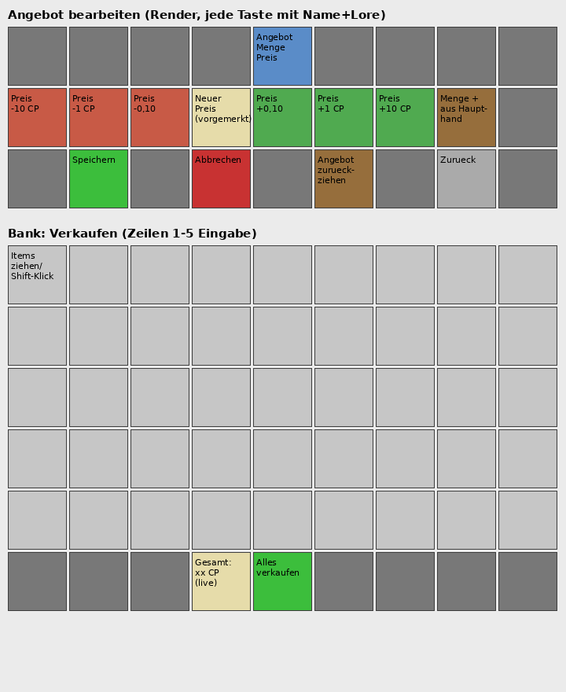

# Markt-GUIs

## Angebot bearbeiten (27 Slots)

```text
 0 Glas |  1 Glas |  2 Glas |  3 Glas |  4 Angebot |  5 Glas |  6 Glas |  7 Glas |  8 Glas
 9 -10  | 10 -1  | 11 -0,10 | 12 Preis | 13 +0,10 | 14 +1 | 15 +10 | 16 Nachfuellen | 17 Glas
18 Glas | 19 Speichern | 20 Glas | 21 Abbrechen | 22 Glas | 23 Zurueckziehen | 24 Glas | 25 Zurueck | 26 Glas
```

Preisaenderungen werden erst mit Speichern uebernommen. Nachfuellen aus der Haupthand erfolgt sofort; Abbrechen verwirft nur den vorgemerkten Preis. Zurueckziehen legt das Angebot ins Abholfach.

## Bank: Verkaufen (54 Slots)

```text
 0-8   Eingabe
 9-17  Eingabe
18-26  Eingabe
27-35  Eingabe
36-44  Eingabe
45-47  frei | 48 Gesamt | 49 Alles verkaufen | 50-53 frei
```

Stacks lassen sich ziehen oder per Umschaltklick einlegen. Unverkaufbare Items gehen zurueck ins Inventar, bei Platzmangel ins Abholfach. Die Vorschau ist unverbindlich; Verkaufspreise und Limits werden beim Verkauf geprueft.

## Bank-Verkaufspreis

Pro Stueck gilt: `Gesamt = Basis * Haltbarkeitsfaktor + min(Verzauberungsbonus, Maximum)`. Der Haltbarkeitsfaktor ist `(maximale Haltbarkeit - Schaden) / maximale Haltbarkeit`, bei Items ohne Haltbarkeit 1. Der optionale Mindestfaktor wird auf diesen Faktor angewandt. Der angepasste Basispreis wird auf ganze Cent abgerundet.

Der rohe Verzauberungsbonus ist die Summe aus Stufe mal Bonus pro Stufe fuer jede Verzauberung; Flueche zaehlen nicht. Der Bonus wird unabhaengig von der Haltbarkeit gedeckelt. Die Vorschau zeigt Basis, Haltbarkeitsabzug, rohen Bonus (mit Deckelungshinweis, falls zutreffend) und Gesamtpreis pro Stueck.

Konfiguration unter `market.sell` (Geldwerte in CP; 1 CP = 100 Cent):

- `enchant.bonus-per-level`: Standardbonus pro Stufe (Standard 1 CP).
- `enchant.overrides`: Bonus pro Stufe fuer einzelne Verzauberungen, etwa `sharpness` oder `minecraft:sharpness`.
- `enchant.max-bonus`: Hoechstbonus pro Item (Standard 5 CP bzw. 500 Cent).
- `durability.min-factor`: Mindestfaktor fuer die Basis (Standard 0).
- `tipped-arrow-price`: optionaler Basispreis fuer Traenkenpfeile; sonst gilt der normale Marktkurs.



Render der Slot-Belegung (kein Ingame-Screenshot; Ingame-Test durch Nils steht aus).
